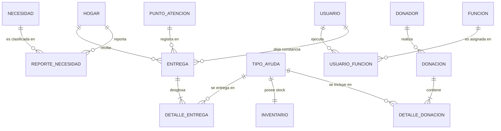

# TALLER-OPERACION-MAREA-ALTA-GRUPO-LUYGY-MIGUEL-DANIEL-BOLANOS

## Integrantes
#1 Juan Camilo Bolaños Salcedo
#2 Miguel Ángel Ruiz Gil
#3 Daniel Ciro Grarcia
#4 luygy Ruben Vivas Moreno


## 📌 01. Contexto de la Emergencia y Misión
El 10 de agosto de 2026, un sismo de magnitud 7,4 con epicentro en San José del Palmar (Chocó) afectó al distrito de Buenaventura (Valle del Cauca). La misión consiste en diseñar una base de datos relacional robusta, consistente y trazable que administre la ayuda humanitaria: desde la recepción de las donaciones y el control de inventarios, hasta el levantamiento de necesidades familiares y la entrega efectiva a los hogares en los puntos de atención urbanos y rurales.

---

## 📖 02. Glosario de Conceptos (Etapa 1)
Definiciones concisas en una sola oración vinculadas directamente al escenario de la emergencia:

1. **Hogar:** Unidad familiar damnificada por el sismo que posee un identificador único e inmutable, con registro de integrantes y condiciones de vulnerabilidad para priorizar la atención.
2. **Punto de Atención:** Espacio físico o centro de acopio habilitado en zona urbana o rural del distrito desde donde se coordina y efectúa la entrega de ayudas.
3. **Donador:** Persona natural, empresa privada, entidad gubernamental u organización comunitaria que realiza aportes humanitarios para atender la emergencia.
4. **Donación:** Evento formal mediante el cual se recepcionan uno o más tipos de suministros entregados por un donador en una fecha específica.
5. **Tipo de Ayuda:** Bien o insumo humanitario estandarizado (alimento, agua potable, kit de aseo, medicamento o abrigo) que cuenta con una unidad de medida homogénea para todos sus movimientos.
6. **Inventario:** Saldo consolidado en tiempo real de las existencias disponibles por cada tipo de ayuda que previene desabastecimientos y saldos negativos.
7. **Necesidad:** Categoría de carencia vital requerida por la población afectada para su subsistencia y recuperación inmediata.
8. **Reporte de Necesidad:** Registro circunstanciado del requerimiento de un hogar que indica urgencia, cantidad estimada, estado de atención y observaciones de campo.
9. **Entrega:** Acto de distribución en el que un hogar recibe suministros en un punto de atención determinado en una fecha y hora verificables.
10. **Detalle de Entrega:** Desglose específico de las cantidades de cada tipo de ayuda efectivamente otorgadas a un hogar en una entrega puntual.
11. **Usuario:** Funcionario, voluntario o brigadista acreditado para interactuar con la base de datos bajo un identificador y correo institucional.
12. **Función:** Perfil de responsabilidad y permisos asignable a un usuario (ej. registro de hogares, coordinación de inventario o entrega) que puede activarse o concluirse dinámicamente.

---

## 🧠 03. Inventario de Decisiones de Diseño (Etapa 2)

Siguiendo las pautas metodológicas de clase del profesor Gonzalo Lucio Lucio:

1. **Nombres de entidades y tablas en singular:** Todas las relaciones y tablas se nombran en singular (`HOGAR`, `DONACION`, `ENTREGA`, `TIPO_AYUDA`, etc.).
2. **Identificador estándar `id` como Clave Primaria (PK):** Tanto tablas independientes (fuertes) como dependientes e intermedias poseen una clave primaria `id` (entero autonumérico).
3. **Claves foráneas con prefijo `id_`:** Las claves foráneas se nombran con el prefijo `id_` seguido del nombre de la tabla padre referenciada (`id_hogar`, `id_necesidad`, `id_donador`, `id_tipo_ayuda`, `id_punto_atencion`, `id_usuario`, `id_funcion`), facilitando el seguimiento de la integridad referencial.
4. **Destrucción de relaciones Muchos a Muchos (N:M):**
   * `HOGAR` ⟷ `NECESIDAD`: Se destruye la relación N:M creando la entidad asociativa `REPORTE_NECESIDAD`, que aloja atributos propios como urgencia, cantidad estimada, estado y observación.
   * `DONACION` ⟷ `TIPO_AYUDA`: Se destruye creando `DETALLE_DONACION`, alojando la cantidad recibida.
   * `ENTREGA` ⟷ `TIPO_AYUDA`: Se destruye creando `DETALLE_ENTREGA`, alojando la cantidad entregada.
   * `USUARIO` ⟷ `FUNCION`: Se destruye creando `USUARIO_FUNCION`, alojando las fechas de inicio/fin y estado activo.
5. **Diferenciación de fechas en `ENTREGA` (Regla R-12):** Se contemplan explícitamente `fecha_entrega` (momento real del hecho físico de distribución) y `fecha_registro` (momento en que el usuario sube el dato al sistema), permitiendo auditar rezagos en el registro.
6. **Estandarización de Unidades de Medida (Regla R-13):** Cada `TIPO_AYUDA` posee su unidad de medida estándar (`cantidad_medida`). Las donaciones en unidades heterogéneas (ej. arrobas de arroz) se convierten previamente a la unidad base (ej. libras) antes de impactar el sistema.
7. **Control de Inventario y no negatividad (Regla R-14):** Se vincula `INVENTARIO` con `TIPO_AYUDA` con restricción `CHECK (cantidad_stock >= 0)`. Toda confirmación de entrega se valida en una transacción atómica que descuenta el stock o rechaza la operación si no hay disponibilidad.

---

## 📊 04. Diagrama Entidad-Relación y Estructura



---

## 🧪 05. Validación de los Casos de Negocio (Casos A – G)

* **CASO A — Un hogar, varias necesidades:**  
  El hogar tiene un `id` único. Sus requerimientos se registran como filas separadas en `REPORTE_NECESIDAD` (una para 'Agua potable' con urgencia Alta, otra para 'Elementos de aseo' con urgencia Media). Al atenderse el agua, solo se actualiza su campo `estado = 'Atendida'`, mientras el registro de aseo permanece `estado = 'Pendiente'`.
* **CASO B — Una donación heterogénea:**  
  La donación de los 120 kits de alimentos, 300 litros de agua y 40 mantas se registra con una única cabecera en `DONACION` y tres renglones en `DETALLE_DONACION`. Para las 2 arrobas de arroz, se convierten a 50 libras antes del ingreso y se registran 50 libras en `DETALLE_DONACION`, manteniendo `cantidad_medida = 'libra'` en `TIPO_AYUDA` y sumando al inventario sin mezclar unidades.
* **CASO C — Una entrega con varios artículos:**  
  Se crea una fila en `ENTREGA` con `fecha_entrega = '2026-08-12'` y `fecha_registro = '2026-08-13'`. En `DETALLE_ENTREGA` se asocian dos registros: uno para 2 kits de alimentos y otro para 10 litros de agua, trazando exactamente cantidades, beneficiario y responsable.
* **CASO D — Entregas sucesivas:**  
  Al volver el hogar cuatro días después a otro punto de atención, se registra un nuevo registro en `ENTREGA` con el `id_punto_atencion` nuevo y fecha actual. La clave foránea `id_hogar` asocia ambas entregas sin sobreescribir la anterior, permitiendo consultar el historial cronológico completo del hogar.
* **CASO E — Inventario insuficiente:**  
  Si quedan 8 unidades en `INVENTARIO.cantidad_stock` y se solicita una entrega de 10, la transacción verifica `cantidad_stock - 10 >= 0`. Al ser falso, el motor de base de datos o la lógica de control rechaza la operación (`ROLLBACK`), impidiendo saldos negativos en estricto cumplimiento de la regla R-14.
* **CASO F — Funciones simultáneas:**  
  La persona tiene un registro en `USUARIO`. En `USUARIO_FUNCION` tiene dos filas: una para 'Registro de Hogares' y otra para 'Coordinación de Inventario'. Cuando deja la primera función, se actualiza dicha asignación fijando `fecha_fin = NOW()` y `activo = FALSE`, conservando activa su función de consulta/coordinación sin tocar su usuario.
* **CASO G — Prevención de datos duplicados:**  
  Dado que los nombres pueden presentar variaciones menores de digitación por los brigadistas, el sistema implementa una regla de control por documento de identidad de la persona de contacto, cruzado con la división territorial y referencia de ubicación. Al detectar una coincidencia cercana, el sistema genera una alerta de posible homónimo o duplicidad para validación previa en campo.

---

##  06. Estructura de Entregables en el Repositorio

Cumpliendo con la sección **07 / ENTREGA EN GITHUB** del reto, este repositorio contiene exactamente los archivos solicitados:

```text
repositorio-del-equipo/
├── README.md               <- Presentación del equipo, contexto y justificación técnica
├── 01_boceto_manual.pdf    <- Copia digitalizada del modelo elaborado a mano en clase
├── 02_modelo_conceptual.pdf<- Diagrama Entidad-Relación final validado
└── 03_modelo_relacional.md <- Esquema relacional formal, atributos, claves PK/FK y reglas
```

---

## ✅ 07. Lista de Chequeo de Criterios de Evaluación
- [x] El repositorio identifica al equipo y a sus integrantes.
- [x] Se adjunta la copia legible del boceto elaborado a mano (`01_boceto_manual.pdf`).
- [x] El modelo conceptual incluye entidades, atributos, claves y cardinalidades (`02_modelo_conceptual.pdf`).
- [x] El modelo relacional identifica tablas, claves primarias y claves foráneas (`03_modelo_relacional.md`).
- [x] Las relaciones de muchos a muchos fueron destruidas y resueltas con tablas asociativas.
- [x] El modelo conceptual y el relacional usan nombres consistentes y unificados.
- [x] Los casos de negocio A–G están plenamente resueltos y verificados.
- [x] Todos los archivos son legibles directamente en GitHub.
